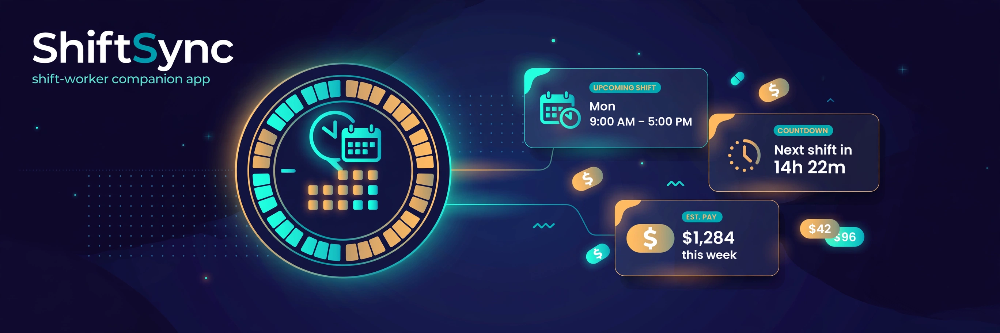

# ShiftSync



**The shift-worker companion app.** ShiftSync keeps your work schedule, your paycheck math, and your coworker swap deals in one place — built for people whose weeks don't run Monday-to-Friday, 9-to-5.

100% offline. No accounts, no API keys, no network calls — your schedule never leaves your phone.

## Features

- **Shift schedule** — add shifts with date, start/end times, role, hourly rate, and notes. Overnight shifts (10 PM → 6 AM) work naturally.
- **Next-shift countdown** — live countdown to your next shift ("2d 4h 12m"), plus an "on shift now" state and a heads-up when a shift starts within the hour.
- **Pay estimator** — estimates earnings per week or month with real overtime logic: hours are bucketed into Monday-start weeks, the first 40 h (configurable) are paid at each shift's own rate, and overtime hours are paid at 1.5× (configurable). Handles mixed pay rates correctly — overtime pay is computed from the rate of the actual overtime hours.
- **Coworker swap board** — post a shift you're giving up, claim open swaps from coworkers, cancel your own posts. Guards against double-posting, claiming your own post, and posting shifts that already started.

## Project structure

```
ShiftSync/
├── Package.swift                  # Swift Package Manager — pure-logic library + tests
├── Sources/ShiftSync/             # Business logic (Foundation only, no UI imports)
│   ├── Shift.swift                # Shift model: duration, overnight, gross pay
│   ├── ShiftStore.swift           # In-memory schedule + JSON persistence helpers
│   ├── ShiftValidation.swift      # Input validation (end > start, ≤ 24 h, rate ≥ 0 …)
│   ├── NextShift.swift            # Current/next shift lookup + countdown math
│   ├── PayEstimator.swift         # Weekly overtime pay breakdown
│   ├── SwapBoard.swift            # Swap post/claim/cancel state machine
│   └── DateProvider.swift         # Injectable clock (System vs Fixed, for tests)
├── App/                           # SwiftUI iOS app (Xcode target, not part of `swift test`)
│   ├── ShiftSyncApp.swift         # @main entry point
│   ├── ContentView.swift          # TabView: Schedule · Pay · Swaps
│   ├── ViewModels.swift           # @Observable view models + JSON file persistence
│   ├── ShiftListView.swift        # Countdown card + grouped schedule, swipe actions
│   ├── ShiftFormView.swift        # Add/edit shift form with live pay estimate
│   ├── PayView.swift              # Period picker + regular/overtime breakdown
│   └── SwapBoardView.swift        # Post shifts, claim swaps, set your name
├── Tests/ShiftSyncTests/          # XCTest suite for all business logic
└── docs/hero-banner.png
```

## Run the logic tests (no Xcode needed)

The business logic is a pure Swift package — no SwiftUI, no Apple-only frameworks.

```bash
swift test
```

## Open the iOS app in Xcode

1. Open Xcode → **File → New → Project → iOS → App**, name it `ShiftSync`.
2. **File → Add Package Dependencies → Add Local…** and select this folder.
3. In the app target's **Frameworks, Libraries, and Embedded Content**, add `ShiftSync`.
4. Drag the `App/` folder's `.swift` files into the Xcode project (uncheck "Copy items if needed" is fine — or copy them in).
5. Build & run on a simulator (iOS 17+).

> The `App/` folder is intentionally outside the SwiftPM build: `swift test` on Linux/macOS compiles and tests only the pure logic, while the SwiftUI layer is written for Xcode on a Mac (Swift 5.9+, iOS 17).

## Tech stack

- Swift 5.9+, SwiftUI, `@Observable`
- Swift Package Manager (logic as a versioned library target)
- XCTest for the logic suite
- JSON file persistence in the app's documents directory

## License

MIT — see [LICENSE](LICENSE).
